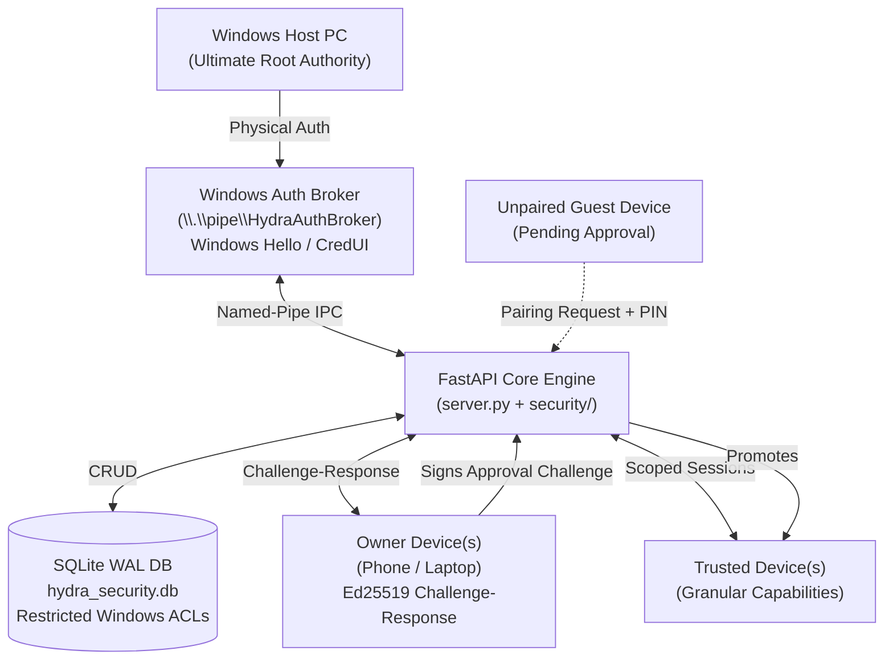

# Hydra Web File Manager — Version 3.0.0 Feature Specification

> **Version**: 3.0.0 (Major Release)  
> **Status**: Production Ready for Core v3 Pillars (Multi-Upload, Name-Protected Download, Nested ZIPs, PC-Controlled Security & Device Pairing)  
> **Platform**: Windows 10 / 11, Cross-Platform Mobile Web (iOS Safari, Android Chrome)  
> **Backend**: Python 3.10+, FastAPI, Uvicorn, WebSockets  
> **Frontend**: Vanilla JavaScript (ES6+), Tailwind CSS, Lucide Icons, TweetNaCl (Zero npm build steps)

---

## 📌 Executive Summary

Following the production release of **v2.0.0** (which delivered native script execution, chat-head multitasking, `desktop.ini` folder icons, persistent favorites, clipboard inspection, and natural sorting), **Version 3.0.0** introduces a high-throughput, conflict-free file transfer engine, together with a zero-trust **PC-controlled multi-owner security and cryptographic device pairing architecture**.

### v3.0 Feature Pillars

| Feature | Status | Description |
| :--- | :--- | :--- |
| **1. Bulk Multi-Select & Selection Engine** | **✅ Production Ready** | Marquee drag selection (mouse & touch long-press), conflict-free single-click open, checkbox isolation, and `Ctrl`/`Shift` modifiers. |
| **2. Smart Download Engine (Name Protection)** | **✅ Production Ready** | Single files download with exact original name protected (zero ZIP wrapping); folders & multi-selections stream as nested ZIPs. |
| **3. Mobile Multi-Upload & Nested Folder Ingestion** | **✅ Production Ready** | Native multi-file picker for phone photos/videos, full directory tree upload via `webkitdirectory` & drag-drop, and floating upload drawer. |
| **4. PC-Controlled Multi-Owner Security & Device Pairing** | **✅ Production Ready** | Windows PC root authority, Windows Hello broker, universal LAN mobile Ed25519 cryptography (TweetNaCl + WebCrypto), cryptographic challenge-response pairing, capability-based permissions, and emergency lockdown. |
| **5. Deep File Search & Instant Token Filters** | 📋 Planned | Substring, extension, and regex search across nested subfolders with cancellation tokens. |

---

## 1. 🖱️ Conflict-Free Interaction Architecture

Designed to ensure batch multi-selection never conflicts with normal folder navigation or single-click file viewing.

```
┌────────────────────────────────────────────────────────────────────────┐
│                   v3.0 Conflict-Free Interaction Model                 │
├────────────────────────────────────────────────────────────────────────┤
│  Normal State (0 Selected)         Active Selection (≥ 1 Selected)     │
│  ├─ Single Click: Opens file/dir    ├─ Single Click: Toggles select    │
│  ├─ Checkbox Tap: Selects item     ├─ Clear (✕): Returns to normal open│
│  ├─ Ctrl+Click: Toggles select     ├─ Floating Dock: ZIP, Copy, Delete │
│  └─ Marquee Drag: Lasso selects    └─ Hold Drag: Expands selection     │
└────────────────────────────────────────────────────────────────────────┘
```

### Core Interaction Rules
1. **Normal Single-Click (0 Selected)**: Tapping or clicking any file or folder card strictly **opens** it (navigates into directory or opens preview modal).
2. **Dedicated Checkbox Target**: Tapping the top-left checkmark badge directly selects the item without opening.
3. **`Ctrl` / `Cmd` + Click**: Toggles individual item selection on desktop without triggering folder navigation.
4. **`Shift` + Click**: Instant range selection between the last clicked item and current target.
5. **Active Selection Mode**: As soon as $\ge 1$ item is selected, card clicks toggle selection state. Clicking **Clear** or the **✕** button instantly disengages selection mode and restores standard single-click navigation.

### Desktop & Mobile Gestures
* **Desktop Left-Click Marquee**: Dragging left mouse button across the canvas renders a subtle rubber-band marquee box (`#selectionMarquee`) with real-time 2D AABB bounding collision. Supports additive selection with `Ctrl`.
* **Mobile Touch Long-Hold Lasso**: Holding a finger for **320ms** triggers a gentle haptic vibration (`navigator.vibrate`) and pulse ring (`#longPressRing`), locks native page scrolling (`e.preventDefault()`), and lasso-selects every card crossed by the drag path.
* **Toned-Down Dark Visuals**: Selected cards use a soft oceanic blue tint (`bg-brand-500/15`), crisp border highlight (`border-brand-500/60`), and natural dark elevation (`shadow-black/40`), eliminating neon cyan glare.

---

## 2. 🛡️ Smart Download Engine: Single File Name Protection vs. Nested ZIPs

Solves the common web file manager pitfall where downloading a single file either forces an unwanted `.zip` archive or corrupts the filename.

```
┌────────────────────────────────────────────────────────────────────────┐
│                        Smart Download Routing                          │
├────────────────────────────────────────────────────────────────────────┤
│ Selection Type         Route                     Download Result       │
├────────────────────────────────────────────────────────────────────────┤
│ Single File (e.g. .png)│ GET /api/fs/raw?download=true ──> original_name.png │
│ Single Folder          │ POST /api/fs/download-zip ──────> FolderName.zip   │
│ Multiple Files/Folders │ POST /api/fs/download-zip ──────> hydra_bundle.zip │
└────────────────────────────────────────────────────────────────────────┘
```

### Download Rules
1. **Case A: Single File Selected**:
   - **Route**: `GET /api/fs/raw?path=...&download=true`
   - **Protection**: Sent via HTTP `Content-Disposition: attachment; filename="<original_exact_name>"`.
   - **Zero Archive Wrapping**: The file downloads directly in its native format with original name and extension completely preserved.
2. **Case B: Single Folder Selected**:
   - **Route**: `POST /api/fs/download-zip` with `paths: [folder_path]`
   - **Result**: Streams as `<folder_basename>.zip`. Inside the zip, the folder's entire nested hierarchy is preserved **as-is**.
3. **Case C: Multiple Items Selected**:
   - **Route**: `POST /api/fs/download-zip` with `paths: [path1, path2, ...]`
   - **Result**: Streams as `hydra_bundle_YYYYMMDD_HHMMSS.zip`. Loose files remain at root level; selected folders retain their exact internal subfolder trees nested **as-is**.
   - **Zero Disk Bloat**: Utilizes FastAPI's `BackgroundTask(os.remove, temp_zip.name)` to instantly purge temporary `.zip` files from the host drive upon stream completion.

---

## 3. 📤 Mobile Multi-Upload & Recursive Nested Directory Ingestion

Provides high-speed transfer from mobile devices and desktop clients to the host PC over local Wi-Fi without flattening nested directories.

```
💻 Client (Mobile Multi-Picker or Desktop Drag)
          │
          │ 1. Upload loose files OR entire folder tree
          ▼
┌────────────────────────────────────────────────────────────────────────┐
│ HTML5 FileSystem Traversal & webkitRelativePath Extraction             │
│ Extracts:                                                              │
│ ├─ Vacation/2026/May/beach.jpg                                         │
│ ├─ Vacation/2026/May/dinner.jpg                                        │
│ └─ Vacation/notes.txt                                                  │
└────────────────────────────────────────────────────────────────────────┘
          │
          │ 2. POST /api/fs/upload with FormData & relative_paths JSON
          ▼
┌────────────────────────────────────────────────────────────────────────┐
│ FastAPI Backend Ingestion Engine                                       │
│ ├─ Sanitizes relative paths (prevents ../ directory escape)            │
│ ├─ os.makedirs(target_subfolder, exist_ok=True)                        │
│ └─ Streams file chunks directly into place                             │
└────────────────────────────────────────────────────────────────────────┘
          │
          │ 3. Telemetry sent to non-blocking floating drawer
          ▼
┌────────────────────────────────────────────────────────────────────────┐
│ 📤 Floating Upload Progress Drawer                                     │
│ ├─ Overall Progress: 78% • 28.4 MB/s (Local LAN)                       │
│ ├─ File List: Vacation/2026/May/beach.jpg (4.2 MB)                     │
│ └─ Non-Blocking: Users can browse other folders while upload finishes  │
└────────────────────────────────────────────────────────────────────────┘
```

### Key Capabilities
1. **Mobile Web Multi-File Selection**:
   - Integrates `<input type="file" multiple>` tailored for mobile touch browsers.
   - Users can tap once to multi-select dozens of photos, 4K videos, or documents from iOS Safari Photos / Files or Android Chrome media picker.
2. **Full Recursive Folder Tree Upload**:
   - Integrates `<input type="file" webkitdirectory directory multiple>` allowing users to upload entire folder structures at once.
   - Desktop clients can drag and drop entire folders directly onto the full-screen `#dropZoneOverlay`.
   - The browser walks the directory tree recursively via `webkitGetAsEntry()` and `createReader()`, attaching relative directory paths.
3. **Preserves Nested Hierarchy As-Is**:
   - The backend reads `relative_paths` metadata, automatically creating all parent directories (`os.makedirs(..., exist_ok=True)`) before writing files.
4. **Non-Blocking Floating Upload Drawer**:
   - Uploads run in the background inside `#uploadDrawer` at the bottom right.
   - Shows overall progress ($0\% \to 100\%$), throughput speed (`MB/s`), and file counter.
   - The user can freely navigate and browse other directories while uploads continue streaming.

---

## 4. 🛡️ PC-Controlled Multi-Owner Security & Universal Device Pairing

HYDRA has evolved from a simple LAN file manager into a local-first PC management platform. The security architecture enforces a core tenet: **The Windows PC is the root authority.** Devices receive authority from the PC; they never independently own the PC.



### 1. Ownership & Device Hierarchy

| Category | Role Description | Permitted Capabilities | Prohibited Capabilities |
| :--- | :--- | :--- | :--- |
| **Owner Devices** | Primary owner and registered co-owners. | Access authorized functionality, review connected devices, approve pending device pairings, receive security notifications, trigger lockdown. | Cannot add/remove owners or modify owner registry remotely. All owner registry changes require fresh local Windows Hello auth on the PC. |
| **Trusted Devices** | Registered devices with explicitly granted permissions. | Perform actions explicitly authorized by capability tokens (`filesystem.read`, `filesystem.write`, `execution.script`, etc.). | Cannot approve other devices, access owner registry, or manage permissions. |
| **Pending Devices** | Unregistered or guest devices. | Zero access to filesystem APIs, execution engines, WebSockets, or process managers. Can only submit pairing requests and poll status. | Blocked from all operational endpoints. |

### 2. First-Time Owner Registration (`INITIAL_SETUP`)

1. Platform starts in `INITIAL_SETUP` state if no owners exist in `hydra_security.db`.
2. A client scans the QR code and enters the enrollment PIN.
3. The server validates the PIN against an Argon2id hash (`m=65536, t=3, p=2`).
4. The client generates an Ed25519 key pair.
5. The local **Windows Auth Broker** prompts interactive **Windows Hello** (biometric fingerprint/face or Windows PIN) on the PC screen.
6. Only upon verified Windows Hello authentication is the first owner registered (`primary-owner`).
7. `INITIAL_SETUP` is permanently disabled once the first owner exists.

### 3. Subsequent Device Pairing Workflow

```
[ Mobile Phone / Guest ]                                     [ Windows Host PC ]
          │                                                            │
          │ 1. Open LAN URL / Scan QR                                  │
          │ 2. Enter Enrollment PIN                                    │
          │ 3. Select Requested Permissions                            │
          │ 4. Generate Ed25519 Key Pair                               │
          │ 5. POST /api/pairing/request                               │
          ├───────────────────────────────────────────────────────────>│
          │                                                            │ 6. Real-time badge: Pending (1)
          │ 7. Live Polling (/api/pairing/status/{id})                 │ 7. Owner reviews device info & fingerprint
          │    "⏳ Waiting for approval on your PC..."                  │ 8. Owner signs challenge:
          │                                                            │    HYDRA-APPROVE:<challenge>:<req_id>
          │                                                            │ 9. POST /api/pairing/approve
          │<───────────────────────────────────────────────────────────┤
          │                                                            │
          │ 10. Poller detects "approved"                              │
          │ 11. Challenge-Response Login:                              │
          │     HYDRA-LOGIN:<challenge>:<device_id>                   │
          │ 12. Receives device-bound session token                    │
          ▼                                                            ▼
[ ✅ Activated as Trusted Device ]                             [ Device Monitored in Registry ]
```

### 4. Universal LAN & Mobile Cryptography Engine

Modern Chromium and WebKit mobile browsers disable WebCrypto (`window.crypto.subtle`) when accessed over local Wi-Fi HTTP (`http://192.168.x.x`), triggering `WebCrypto Ed25519 is not supported` errors.

HYDRA resolves this natively with a **Dual-Engine Cryptographic Architecture**:
1. **Locally Bundled TweetNaCl (`static/nacl.min.js`)**:
   - Zero-dependency, audited RFC 8032 pure JavaScript implementation of Ed25519.
   - Relies on `crypto.getRandomValues()`, which is universally enabled in **all** browser contexts (including plain HTTP over local LAN on Android, iOS, Windows, and macOS).
   - Generates Ed25519 public keys and detached 64-byte signatures that are bit-for-bit identical to Python's `cryptography` library and WebCrypto.
   - Operates 100% offline with zero external network or CDN dependencies.
2. **WebCrypto SubtleCrypto Fallback**:
   - Automatically engaged when running inside Secure Contexts (`localhost`, HTTPS).
3. **Dual-Tier Key Persistence**:
   - Stores device keys in browser **IndexedDB** (`hydra_crypto_db`) with fallback mirroring to `localStorage` (`hydra_device_privkey`, `hydra_device_pubkey`).
   - Device identities permanently survive tab reloads, browser restarts, and device reboots.

### 5. PC-Controlled Owner Management & Windows-Local Recovery

All owner registry modifications require physical authorization at the Windows PC:
- **Operations Requiring Local Windows Hello**:
  1. Add a new owner.
  2. Promote a trusted device to co-owner.
  3. Remove an owner (cannot remove the sole remaining owner).
  4. Security lockdown overrides and platform unlock.
- **Windows Local Login Recovery (`POST /api/owners/local-login`)**:
  - If browser cookies or local storage are cleared on the host PC, opening `http://127.0.0.1:8088` displays a **"🛡️ Windows Hello PC Login"** button.
  - Prompts Windows Hello locally on the PC and immediately restores primary owner authority.
  - Strictly restricted to `localhost` / `127.0.0.1`; remote network callers receive HTTP 403 Forbidden.

### 6. Capability-Based Permission Matrix

Each trusted device session carries an immutable list of granted capabilities:

| Permission | Token Name | Description |
| :--- | :--- | :--- |
| **Read Files** | `filesystem.read` | Browse directories, inspect metadata, download files, stream media. |
| **Write Files** | `filesystem.write` | Upload files, create folders, rename, paste, delete to Recycle Bin. |
| **Run Scripts** | `execution.script` | Execute `.bat`, `.cmd`, `.ps1`, `.py` scripts via browser terminal. |
| **Desktop Launch** | `execution.desktop` | Launch interactive desktop windows, consoles, and `.exe` binaries. |
| **Process Manager** | `process.manage` | Inspect live processes, view system resource utilization, terminate tasks. |
| **System Monitor** | `system.monitor` | Stream system performance telemetry (CPU, RAM, disk, network). |
| **Approve Pairing** | `pairing.approve` | Authorize ordinary trusted-device pairing requests (Owner-only). |
| **Screen View** | `screen.view` | Stream host display video (Future capability). |
| **Screen Control** | `screen.control` | Remote mouse and keyboard injection (Future capability). |

### 7. Emergency Security Lockdown State Machine

- When lockdown is active, all script execution, binary launching, new pairing requests, and ownership modifications are instantly halted.
- Existing sessions remain strictly read-only or suspended based on host policy.
- Unlocking the platform requires fresh Windows Hello authentication on the PC via `POST /api/security/unlock`.

---

## 5. 🔌 Version 3.0 API Specification

### File Management & Ingestion

| Method | Endpoint | Description | Auth Required | Required Permission |
| :--- | :--- | :--- | :--- | :--- |
| `POST` | `/api/fs/upload` | Multipart upload supporting multiple files and nested directory trees (`relative_paths` JSON). | Yes (`token`) | `filesystem.write` |
| `POST` | `/api/fs/download-zip` | Packages selected directories and files into a streaming `.zip` with automatic background cleanup. | Yes (`token`) | `filesystem.read` |
| `GET` | `/api/fs/raw` | Streams raw file content with HTTP Range support; `download=true` forces protected native download. | Yes (`token`) | `filesystem.read` |

### Security, Pairing & Device Authority

| Method | Endpoint | Description | Auth Required | Notes |
| :--- | :--- | :--- | :--- | :--- |
| `GET` | `/api/security/status` | Returns security state (`initial_setup`, `operational`, `locked`), device counts, and lockdown status. | No (Public) | Minimal safe telemetry. |
| `POST` | `/api/security/initial-setup` | Registers the first primary owner. Requires Argon2id PIN and Windows Hello local auth. | No (Initial only) | Disabled once owner exists. |
| `POST` | `/api/pairing/request` | Submits device pairing request with device public key, PIN, and requested capabilities. | No (PIN verified) | Device enters pending state. |
| `GET` | `/api/pairing/status/{request_id}` | Polls status of a pairing request (`pending`, `approved`, `rejected`, `expired`). | No (Safe) | Single-device scoped. |
| `POST` | `/api/pairing/challenge/{request_id}` | Issues single-use cryptographic approval challenge. | Yes (Owner only) | Challenge expires in 60s. |
| `POST` | `/api/pairing/approve` | Approves pairing with owner's Ed25519 signature and assigned permissions. | Yes (Owner only) | Promotes to trusted device. |
| `POST` | `/api/pairing/reject` | Rejects a pending pairing request. | Yes (Owner only) | |
| `GET` | `/api/auth/device-challenge` | Issues one-time login challenge for a registered device. | No | Challenge expires in 60s. |
| `POST` | `/api/auth/device-login` | Authenticates device via Ed25519 challenge signature; returns session token. | No (Signed) | Binds session to device identity. |
| `POST` | `/api/owners/local-login` | Windows Hello local recovery login for host PC browser. | No (Localhost only) | Strictly forbidden from LAN. |
| `GET` | `/api/owners` | Lists all registered owner devices with roles, fingerprints, and timestamps. | Yes (Owner only) | |
| `POST` | `/api/owners/request-auth` | Triggers Windows Hello prompt on PC; returns single-use broker approval token. | Yes (Owner only) | Localhost-only broker IPC. |
| `POST` | `/api/owners/local-approve` | Promotes a trusted device to owner using a broker approval token. | Yes (Owner only) | Requires PC Windows Hello. |
| `POST` | `/api/owners/local-remove` | Removes an owner using a broker approval token (cannot remove last owner). | Yes (Owner only) | Requires PC Windows Hello. |
| `GET` | `/api/devices` | Lists all trusted devices and their granted capability permissions. | Yes (Owner only) | |
| `GET` | `/api/devices/pending` | Lists all pending pairing requests. | Yes (Owner only) | |
| `POST` | `/api/devices/revoke` | Immediately revokes a trusted device and invalidates all its active sessions. | Yes (Owner only) | |
| `POST` | `/api/devices/permissions` | Updates capability permissions granted to a trusted device. | Yes (Owner only) | |
| `POST` | `/api/security/lockdown` | Enables security lockdown across the platform. | Yes (Owner only) | Halts execution & pairing. |
| `POST` | `/api/security/unlock` | Disables security lockdown using a broker approval token. | Yes (Owner only) | Requires PC Windows Hello. |
| `GET` | `/api/audit/log` | Returns queryable structured audit events. | Yes (Owner only) | SQLite persistent trail. |

---

## 6. 🚀 v3.0 Verification & Testing Status

| Component | Test Scenarios | Status |
| :--- | :--- | :--- |
| **Single-File Download** | Verified single file downloads with exact native name and extension (no ZIP wrapping). | ✅ Passed |
| **Single-Folder Download** | Verified single folder downloads as `<foldername>.zip` with internal structure nested as-is. | ✅ Passed |
| **Multi-Select Download** | Verified multi-select bundle downloads as `hydra_bundle_...zip` with nested directories as-is. | ✅ Passed |
| **Mobile Multi-Upload** | Verified selecting multiple photos/files via mobile web picker uploads in one batch. | ✅ Passed |
| **Folder Tree Upload** | Verified `webkitdirectory` and desktop folder drag-and-drop recreates nested subfolders as-is. | ✅ Passed |
| **Floating Upload Drawer** | Verified non-blocking background uploads with progress bar, speed, and auto-dismissal. | ✅ Passed |
| **Conflict-Free Gestures** | Verified single-click opens files/folders, checkbox clicks select, and drag marquee works smoothly. | ✅ Passed |
| **Initial Owner Setup** | Verified atomic first-owner registration requiring Argon2id PIN and Windows Hello local auth. | ✅ Passed |
| **Simultaneous Setup Rejection**| Verified race condition prevention: second registration request rejected with HTTP 409. | ✅ Passed |
| **PIN-Only Owner Prevention** | Verified that supplying PIN alone without Windows local broker approval is rejected. | ✅ Passed |
| **Replay Protection** | Verified authorization challenges and login nonces expire and cannot be reused. | ✅ Passed |
| **Cryptographic Pairing** | Verified new device enters pending state, requires owner Ed25519 signature to become trusted. | ✅ Passed |
| **Invalid Signature Rejection**| Verified tampered or mismatched approval signatures are rejected with HTTP 400. | ✅ Passed |
| **Remote Owner Bypass Block** | Verified remote devices cannot create or promote owners without PC local Windows Hello auth. | ✅ Passed |
| **Last Owner Invariant** | Verified platform refuses removal of the sole remaining owner. | ✅ Passed |
| **Device Revocation** | Verified revoking a device immediately invalidates all active sessions and WebSockets. | ✅ Passed |
| **Capability Enforcement** | Verified HTTP endpoints and execution engines reject tokens lacking required permissions. | ✅ Passed |
| **WebSocket Authentication** | Verified execution terminal WebSockets require device session and process ownership. | ✅ Passed |
| **Security Lockdown** | Verified lockdown blocks execution and pairing; unlock requires Windows Hello auth. | ✅ Passed |
| **Universal LAN Cryptography** | Verified TweetNaCl Ed25519 key generation and challenge signing over local HTTP LAN on Android/iOS. | ✅ Passed |
| **Execution Engine Invariants** | Verified 11/11 execution engine tests pass with zero regressions against existing capabilities. | ✅ Passed |
